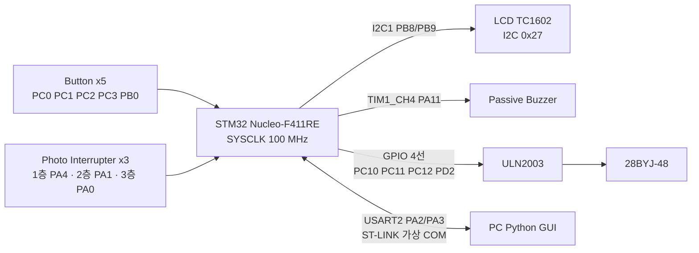
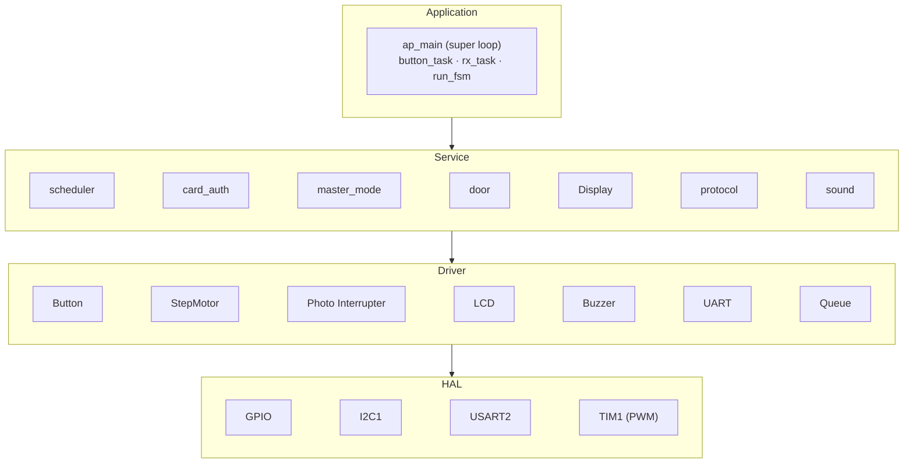
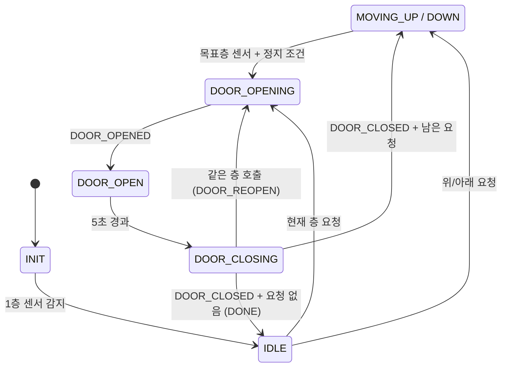

# 11. elevator_teamproject

**Card-Access Hotel Elevator**: **NUCLEO-F411RE**로 만든 3층 카드 권한 엘리베이터입니다. (2인 팀 프로젝트)

카드에 등록된 층으로만 갈 수 있습니다. 스텝모터로 칸을 움직이고 포토인터럽터로 층을 감지하며, PC의 Python GUI와 UART 패킷으로 카드 태그, 문 동작, 상태를 주고받습니다. GUI 안에는 STM32와 같은 운행 규칙을 따로 돌리는 **Python 모델**이 있어서, 보드의 응답이 예상과 같은지 자동으로 비교합니다.

<!-- 데모 영상 링크를 여기에 추가: [Demo Video](https://youtu.be/...) -->

## 한눈에 보기

| 항목 | 내용 |
|---|---|
| 보드 | NUCLEO-F411RE (STM32F411, Cortex-M4, 100 MHz) |
| 구동 | 28BYJ-48 스텝모터 + ULN2003, 3 ms마다 하프스텝 |
| 층 감지 | 슬롯형 포토인터럽터 3개 (판이 막으면 HIGH) |
| 표시, 소리 | I2C LCD 16x2 (현재 층, 문 닫힘 카운트), 패시브 부저 (버튼음) |
| 입력 | 버튼 5개 (외부 리더 1~3층, 내부 리더, 카드 선택), GUI 카드 태그 |
| 통신 | USART2 115200 8N1, 8바이트 고정 프레임, 명령 12종 |
| 구조 | 슈퍼루프, Application / Service / Driver / HAL 4계층, 2-process FSM |
| 검증 | Python 모델과 STM32 응답 비교, 랜덤 시나리오 |

## 기능

| Card Access | Master Mode | Run & Door |
|---|---|---|
| 카드 DB: 손님(2층), 직원(전 층) | 직원 카드로 내부 리더 태그 시 진입 | 방향 우선 운행 |
| 외부 리더 태그 = 그 층 호출 | 5초 안에 층 버튼 1회 입력 | 같은 층 요청은 한 번에 처리 |
| 손님 목적층은 태그 시점에 자동 등록 (1층 ↔ 2층) | 입력 즉시 일반 모드 복귀 | 포토인터럽터로 층 도착 정지 |
| 권한 없는 카드는 응답 없이 무시 | 서 있는 층을 누르면 요청 없이 복귀 | 문 열림 5초 카운트를 LCD에 표시 |
| | | 문 닫힘 신호 전에는 출발 금지 |

| 장치 | 동작 |
|---|---|
| Button | BTN1~3(PC0~PC2) 1~3층 외부 리더, 마스터 모드에서는 층 버튼 · BTN4(PC3) 내부 리더 · BTN5(PB0) 카드 선택 |
| LCD | 1행 `floor : n` · 2행 `Closing in n sec` (문 열림 중) |
| Buzzer | 버튼과 GUI 입력마다 G6 → C7 두 음 (40 ms + 60 ms) |

## 하드웨어



| No | Part | Model / Spec | Qty | Usage / Interface |
|---|---|---|---|---|
| 1 | MCU 보드 | STM32 Nucleo-F411RE | 1 | 메인 제어, ST-LINK 디버깅과 가상 COM |
| 2 | Step Motor | 28BYJ-48 (5V) | 1 | 엘리베이터 승강, 하강 |
| 3 | 모터 드라이버 | ULN2003 드라이버 보드 | 1 | GPIO 4선 → 모터 코일 구동 |
| 4 | 포토인터럽터 | 슬롯형 (LED 330Ω, 풀업 4.7kΩ) | 3 | 층 감지, 판이 막으면 HIGH |
| 5 | LCD | TC1602A-01T 16x2 (I2C) | 1 | I2C1 (주소 0x27), 현재 층과 문 카운트 |
| 6 | Buzzer | Passive Buzzer | 1 | TIM1 CH4 PWM, 버튼음 |
| 7 | Tact Switch | Push Button | 5 | 외부 리더 3, 내부 리더 1, 카드 선택 1 |
| 8 | PC | Python GUI | 1 | USART2 115200, 가상 엘리베이터와 문 |

### 핀 맵

| Function | Signal | Pin | Config |
|---|---|---|---|
| I2C1 (LCD) | SCL / SDA | PB8 / PB9 | I2C |
| USART2 (GUI) | TX / RX | PA2 / PA3 | 115200 8N1 |
| 외부 리더 1~3층 | btn[0~2] | PC0, PC1, PC2 | GPIO Input |
| 내부 리더 | btn[3] | PC3 | GPIO Input |
| 카드 선택 | btn[4] | PB0 | GPIO Input |
| 층 센서 1~3층 | sensor[0~2] | PA4, PA1, PA0 | GPIO Input |
| Motor IN1~4 | motor_pin | PC10, PC11, PC12, PD2 | GPIO Output |
| Buzzer | htim1 CH4 | PA11 | TIM1 PWM |

## 소프트웨어 구조



### 슈퍼루프와 타이밍

```
ap_main: button_task() → rx_task() → run_fsm() → Disp_LCD() → sound_task()  반복
```

- 모든 시간은 `HAL_GetTick()` 비교로 처리하고 FSM 안에 delay가 없습니다. 그래서 이동 중이나 문이 열린 동안에도 카드와 GUI 입력을 처리합니다.
- UART 수신 인터럽트는 프레임을 수신 큐(8칸)에 넣기만 하고, 처리는 `rx_task()`가 메인 루프에서 합니다.

| 타이머 | 시간 | 동작 |
|---|---|---|
| Motor | 3 ms | 3 ms마다 한 스텝 (하프스텝 8패턴). 한 층 구간 30000 스텝 안에 센서를 못 찾으면 정지 |
| Door | 5 s | `DOOR_OPENED` 수신 후 시작, LCD에 5 → 1초 표시, 같은 층 호출이면 다시 5초 |
| Master | 5 s | 내부 리더 태그 후 시작, 층 버튼 1회 입력 또는 5초 경과로 종료, 문 5초와 따로 동작 |

### 상태 머신

2-process FSM입니다. `run_next_state()`가 다음 상태만 계산하고, `run_enter()`와 `run_hold()`가 동작을 실행합니다.



- 어느 상태에서든 GUI `INIT`을 받으면 INIT으로 가서 1층 센서가 감지될 때까지 내려갑니다.
- 마스터 모드는 NORMAL과 MASTER 두 상태라 `bool active` 하나로 구현했고, 운행 FSM과 따로 돌아 서로 기다리지 않습니다.

### 요청 레지스터 (`scheduler.h`)

| bit | 0 | 1 | 2 | 3 | 4 | 5 | 6 |
|---|---|---|---|---|---|---|---|
| 의미 | 1F 상행 호출 | 2F 하행 호출 | 2F 호출 (방향 무관) | 3F 하행 호출 | 목적층 1F | 목적층 2F | 목적층 3F |

층마다 해당 비트를 묶은 마스크(1F `0x11`, 2F `0x26`, 3F `0x48`)로 정지 여부를 판단하고, 진행 방향에 남은 요청이 있으면 방향을 유지합니다.

## 통신 프로토콜

| SOF | LEN | CMD | P0 | P1 | P2 | P3 | CHK |
|---|---|---|---|---|---|---|---|
| 0xAA | 0x05 | 명령 | | | | | LEN+CMD+P0~P3 하위 8비트 |

| 방향 | 명령 |
|---|---|
| PC → STM32 | `CARD_TAG` 0x01, `DEST_BTN` 0x02, `DOOR_OPENED` 0x03, `DOOR_CLOSED` 0x04, `STATUS_REQ` 0x05, `INIT` 0x06 |
| STM32 → PC | `STATUS` 0x81, `ARRIVED` 0x82, `DOOR_CLOSE` 0x83, `DOOR_REOPEN` 0x84, `HW_EVENT` 0x85, `DONE` 0x86 |

- STM32는 프레임을 받을 때마다 `STATUS`(현재 층, 방향, FSM 상태, 요청 레지스터)로 답합니다. GUI는 0.2초마다 `STATUS_REQ`를 보내 상태를 받습니다.
- 문은 GUI에만 있습니다. STM32가 `ARRIVED`를 보내면 GUI가 문을 열고 `DOOR_OPENED`로 답하고, `DOOR_CLOSE`를 보내면 문을 닫고 `DOOR_CLOSED`로 답합니다.

## Python 모델 검증 (`elevator_teamproject/python_model_verification/`)

- STM32와 같은 운행 규칙(scheduler, card_auth, master_mode)을 Python으로 따로 모델링했습니다.
- GUI는 같은 입력을 STM32와 모델에 넣고, STM32가 보낸 도착, 통과, 출발 방향, 요청 레지스터가 모델의 예상과 같은지 비교합니다.
- 화면의 엘리베이터 칸은 모델이 예상한 동작이고, 빨간 점선은 실제 STM32 위치입니다. 둘이 갈라지면 그 자리가 예상과 다른 곳입니다.
- **랜덤 시나리오**: 손님 1~4명, 직원 0~2명을 새로 만들고, 권한 없는 카드나 문 닫히는 중 재태그 같은 방해 입력을 0~3개 섞어 이동 중, 문 열림, 문 닫힘 같은 시점에 넣습니다. 끝났을 때 불일치가 0건이면 PASS입니다.

| 파일 | 역할 |
|---|---|
| `main.py` | 실행 진입점 (pyserial이 없으면 자동 설치) |
| `frontend/app.py` | tkinter 화면 |
| `backend/controller.py` | 연결, STATUS 폴링, 문 핸드셰이크, 입력 송신 |
| `backend/codec.py` | 프레임 만들기와 해석 |
| `backend/link.py` | `SerialLink`(보드), `MockLink`(보드 없이 시험) |
| `backend/mock_fw.py` | 펌웨어 FSM을 흉내 내는 가상 STM32 |
| `backend/model.py` | 운행 규칙 모델, STM32 응답 비교 |
| `backend/model_car.py` | 화면에 그리는 모델 칸 (모델 + 이동 시간, 문 시간) |
| `backend/scenario.py` | 랜덤 시나리오 |
| `backend/state.py` | 화면에 보여 줄 상태 |

## Troubleshooting: 층 센서가 감지되지 않음

| | 내용 |
|---|---|
| Problem | 층 센서가 막혀도 엘리베이터가 멈추지 않고 계속 이동. 로직 아날라이저에서는 센서 신호가 바뀌는데 보드가 읽은 값은 그대로 |
| Cause | PC14, PC15는 보드 기본 설정에서 LSE 크리스털용이라 헤더와 끊겨 있음 (UM1724). PC13은 USER 버튼과 연결 |
| Solution | 센서를 일반 GPIO인 PA4, PA1, PA0으로 옮기고 `photo_interrupt_init()`의 포트와 핀 수정. 판이 막으면 HIGH라 CLOSED는 1 |

| | 센서 핀 (1층, 2층, 3층) | 결과 |
|---|---|---|
| Before | PC15, PC14, PC13 | 센서 값이 바뀌지 않아 층에서 멈추지 않음 |
| After | PA4, PA1, PA0 | 정상 동작 |

## Conclusion & Discussion

**Conclusion**
- 카드 권한, 마스터 모드, 방향 우선 스케줄러를 서비스 모듈로 나눠 구현하고 보드에서 모듈별 시험을 통과했습니다.
- 2-process FSM과 논블로킹 모터 구동으로 이동 중에도 카드와 GUI 입력을 처리합니다.
- 8바이트 UART 프레임과 문 핸드셰이크로 GUI와 동작을 맞췄습니다.

**Discussion**
- 모터가 센서를 못 찾았을 때 GUI에 알리는 프레임이 없습니다.
- 보드 기본 설정에서 쓸 수 없는 핀이 있어, 핀 배정 전에 보드 매뉴얼을 확인해야 합니다.
- 계획서에서 기능, FSM, 핀 배치를 먼저 정하고 그대로 개발에 적용하니 역할 분담과 통합이 수월했습니다.

## 폴더 구성

```
11.elevator_teamproject/
├── README.md
└── elevator_teamproject/
    ├── main.c                     CubeMX 생성 코드 + ap_main() 호출
    ├── ap/                        ap_main.c, service/ (scheduler, card_auth, master_mode, protocol, door, Display, sound, btn_event)
    ├── driver/                    uart, stepmotor, photo_interrupter, lcd, buzzer, button, fnd
    ├── common/queue/              링 버퍼
    ├── python_model_verification/ Python GUI와 검증 모델
    └── 개발계획서/                 elevator_dev_plan_v1.6.md
```

## 실행 방법

**펌웨어**: 이 폴더에는 직접 작성한 소스만 있습니다. CubeMX로 위 핀 맵과 같은 설정(I2C1, USART2 115200, TIM1 CH4 PWM, GPIO)의 프로젝트를 만든 뒤, `elevator_teamproject/` 안의 `ap/`, `driver/`, `common/`, `main.c`를 `Core/Src`에 넣고 빌드합니다.

**GUI**: Python 3가 필요합니다.

```bash
cd elevator_teamproject/python_model_verification
python main.py
```

- Port에서 ST-LINK COM 포트를 고르고 Connect합니다. 보드 없이 시험하려면 `MOCK`을 고릅니다.
- `한 층 이동(초)`는 실제 모터가 한 층 가는 데 걸리는 시간입니다. 자동 측정을 켜 두면 첫 이동 뒤 측정값으로 바뀌고 `settings.json`에 저장됩니다.

## 문서

- [개발계획서 v1.6](elevator_teamproject/개발계획서/elevator_dev_plan_v1.6.md): 요구사항, FSM 상태 전이표, 요청 레지스터, 프로토콜, 예외 처리
