# 11. elevator_teamproject

**Card-Access Hotel Elevator**: **NUCLEO-F411RE**로 만든 3층 카드 권한 엘리베이터입니다. (2인 팀 프로젝트)

카드에 등록된 층으로만 갈 수 있습니다. 스텝모터로 칸을 움직이고 포토인터럽터로 층을 감지하며, PC의 Python GUI와 UART 패킷으로 카드 태그, 문 동작, 상태를 주고받습니다. GUI 안에는 STM32와 같은 운행 규칙을 따로 돌리는 **Python 모델**이 있어서, 보드의 응답이 예상과 같은지 자동으로 비교합니다.

<!-- 데모 영상 링크를 여기에 추가: [Demo Video](https://youtu.be/...) -->

## 한눈에 보기

| 항목 | 내용 |
|---|---|
| 보드 | NUCLEO-F411RE (STM32F411, Cortex-M4, 100 MHz) |
| 구동 | 28BYJ-48 스텝모터 + ULN2003, 3 ms마다 하프스텝 |
| 층 감지 | 슬롯형 포토인터럽터 3개 (판이 막으면 HIGH) |
| 표시, 소리 | I2C LCD 16x2 (현재 층, 문 닫힘 카운트), 패시브 부저 (버튼음) |
| 입력 | 버튼 5개 (외부 리더 1~3층, 내부 리더, 카드 선택), GUI 카드 태그 |
| 통신 | USART2 115200 8N1, 8바이트 고정 프레임, 명령 12종 |
| 구조 | 슈퍼루프, Application / Service / Driver / HAL 4계층, 2-process FSM |
| 검증 | Python 모델과 STM32 응답 비교, 랜덤 시나리오 |

## 목차

1. [Overview](#1-overview)
2. [Functions](#2-functions)
3. [Demo](#3-demo)
4. [BOM](#4-bom-bill-of-materials)
5. [H/W Structure & Pin Map](#5-hw-structure--pin-map)
6. [S/W Structure](#6-sw-structure)
7. [Timing](#7-ap_main--timing)
8. [State Machine](#8-state-machine-fsm)
9. [Troubleshooting](#9-troubleshooting-floor-sensor-not-detected)
10. [Conclusion & Discussion](#10-conclusion--discussion)
11. [통신 프로토콜](#통신-프로토콜) · [Python 모델 검증](#python-모델-검증) · [폴더 구성과 실행 방법](#폴더-구성)

---

## 1. Overview

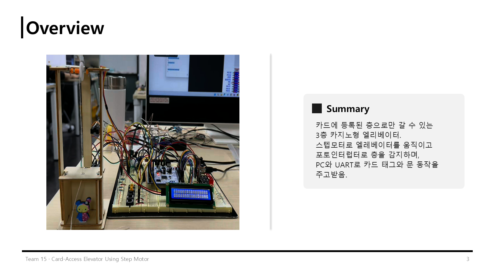

## 2. Functions

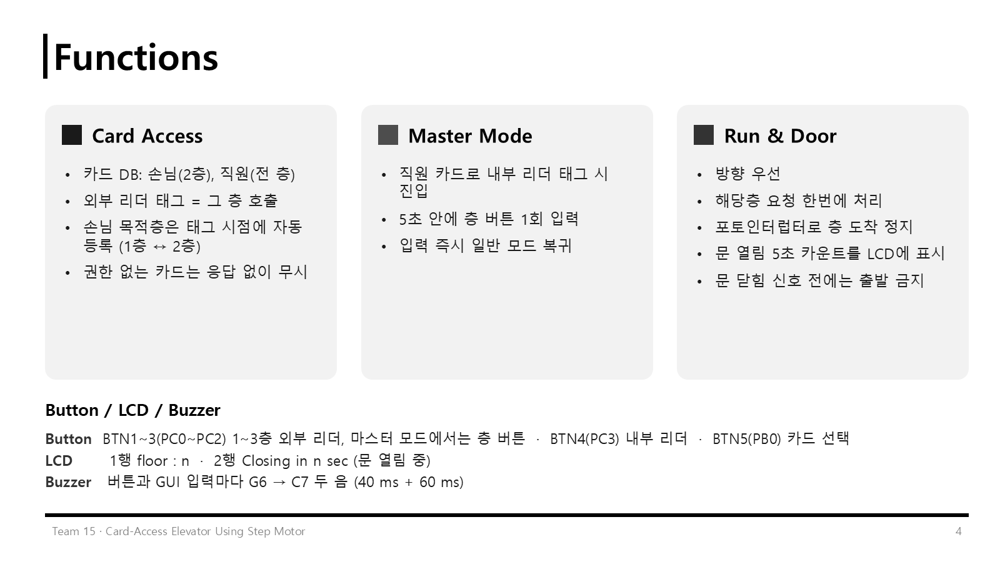

## 3. Demo

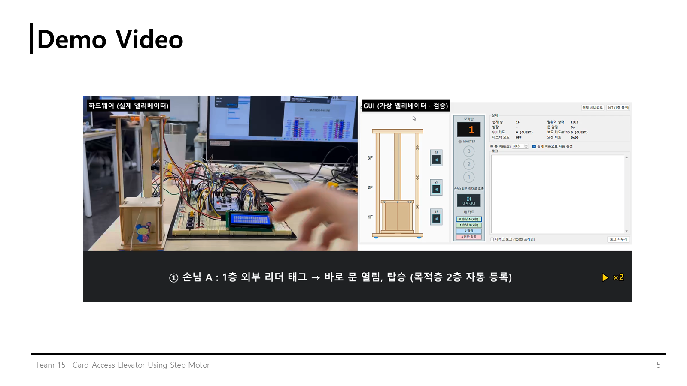

왼쪽은 실제 하드웨어, 오른쪽은 GUI입니다. GUI의 엘리베이터 칸은 Python 모델이 예상한 동작이고, 빨간 점선은 실제 STM32 위치입니다.

## 4. BOM (Bill of Materials)

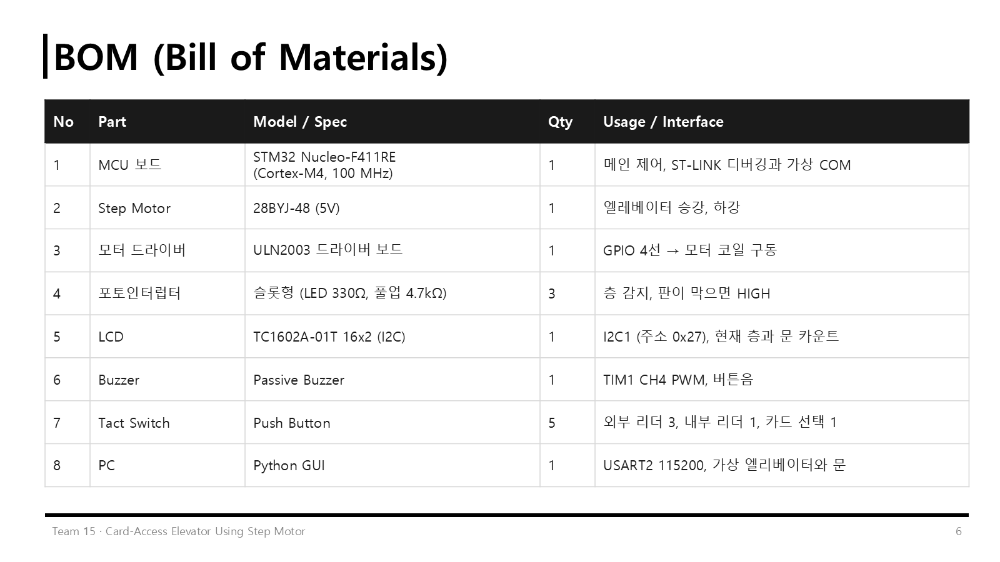

## 5. H/W Structure & Pin Map

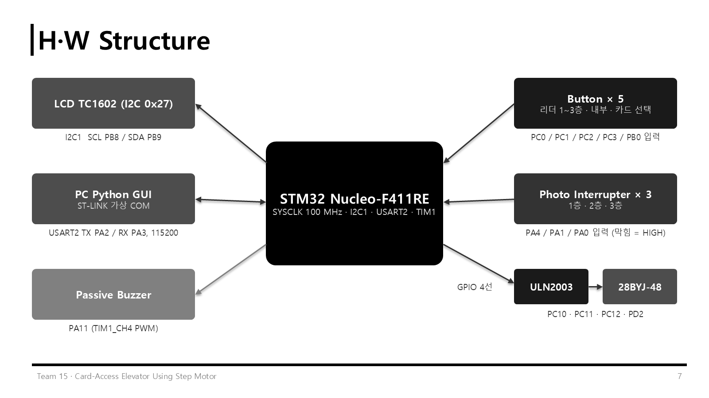

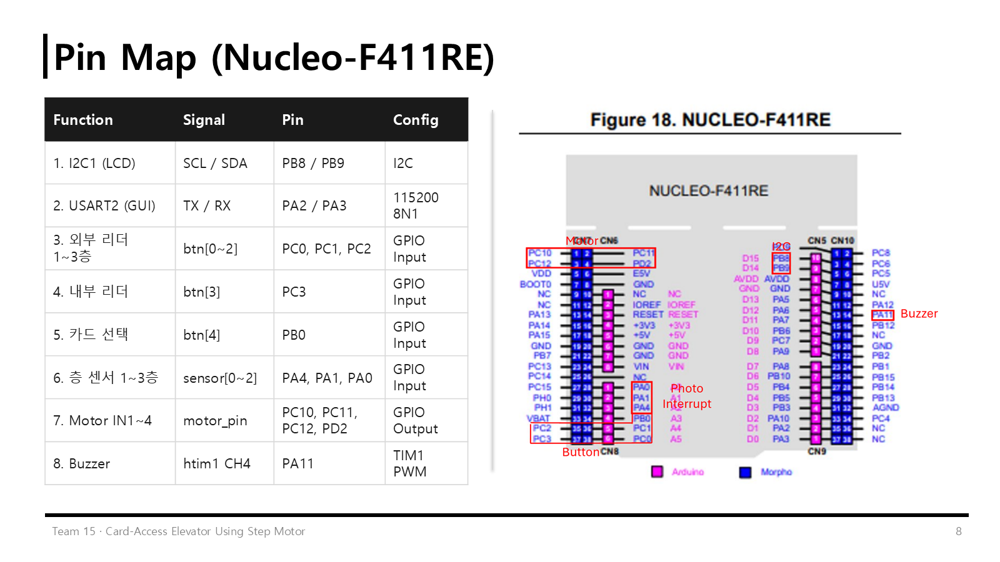

## 6. S/W Structure

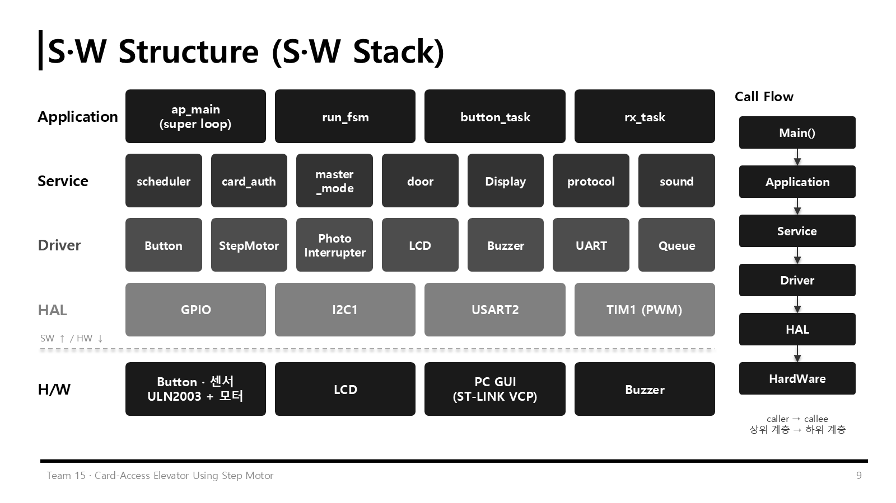

## 7. ap_main & Timing

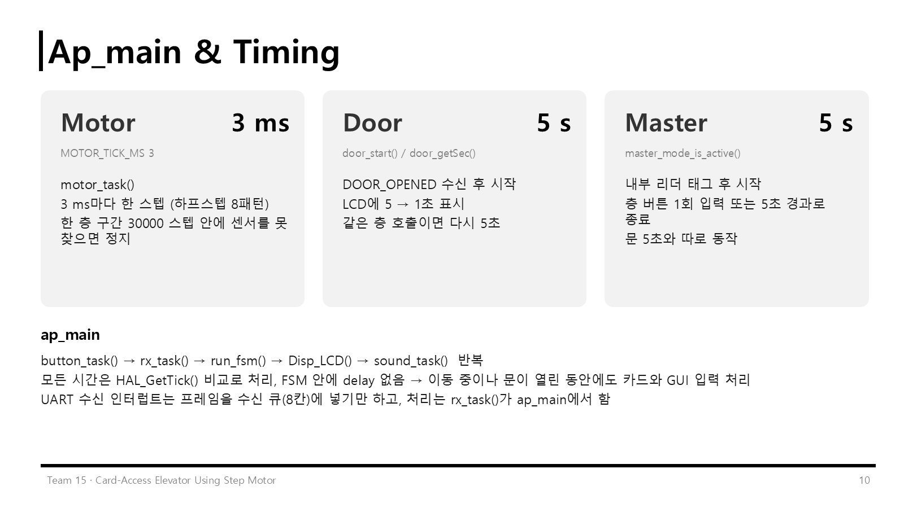

## 8. State Machine (FSM)

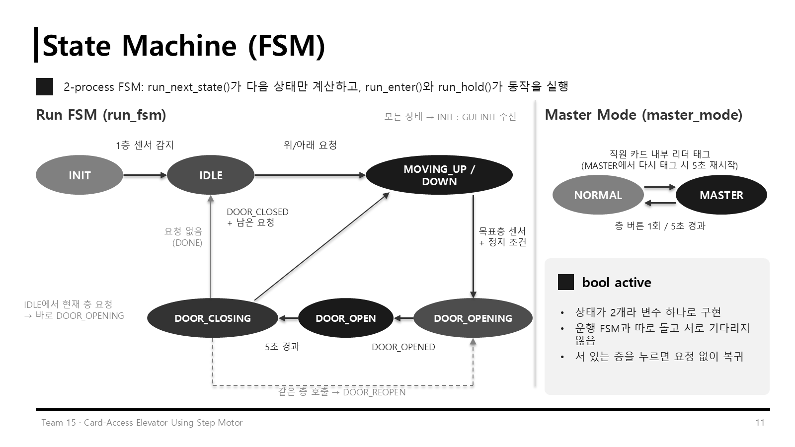

## 9. Troubleshooting: Floor Sensor Not Detected

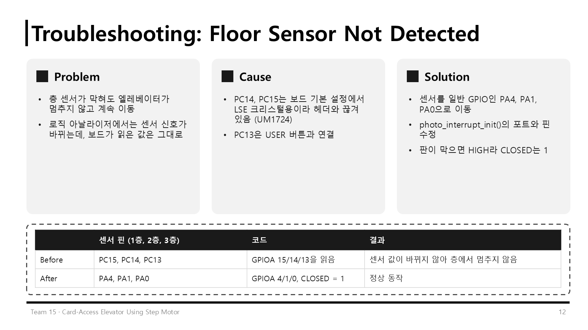

## 10. Conclusion & Discussion

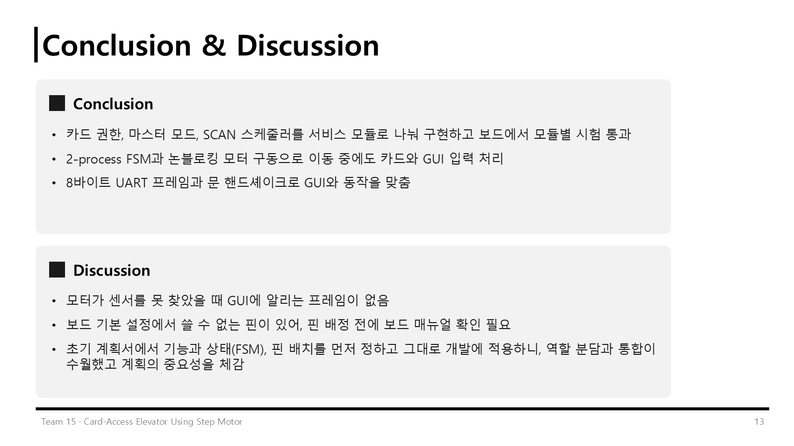

> 슬라이드의 "SCAN 스케줄러"는 끝 층까지 가지 않고 마지막 요청 층에서 방향을 바꾸는 방향 우선(LOOK) 방식입니다.

---

## 통신 프로토콜

| SOF | LEN | CMD | P0 | P1 | P2 | P3 | CHK |
|---|---|---|---|---|---|---|---|
| 0xAA | 0x05 | 명령 | | | | | LEN+CMD+P0~P3 하위 8비트 |

| 방향 | 명령 |
|---|---|
| PC → STM32 | `CARD_TAG` 0x01, `DEST_BTN` 0x02, `DOOR_OPENED` 0x03, `DOOR_CLOSED` 0x04, `STATUS_REQ` 0x05, `INIT` 0x06 |
| STM32 → PC | `STATUS` 0x81, `ARRIVED` 0x82, `DOOR_CLOSE` 0x83, `DOOR_REOPEN` 0x84, `HW_EVENT` 0x85, `DONE` 0x86 |

- STM32는 프레임을 받을 때마다 `STATUS`(현재 층, 방향, FSM 상태, 요청 레지스터)로 답합니다. GUI는 0.2초마다 `STATUS_REQ`를 보내 상태를 받습니다.
- 문은 GUI에만 있습니다. STM32가 `ARRIVED`를 보내면 GUI가 문을 열고 `DOOR_OPENED`로 답하고, `DOOR_CLOSE`를 보내면 문을 닫고 `DOOR_CLOSED`로 답합니다.

### 요청 레지스터 (`scheduler.h`)

| bit | 0 | 1 | 2 | 3 | 4 | 5 | 6 |
|---|---|---|---|---|---|---|---|
| 의미 | 1F 상행 호출 | 2F 하행 호출 | 2F 호출 (방향 무관) | 3F 하행 호출 | 목적층 1F | 목적층 2F | 목적층 3F |

층마다 해당 비트를 묶은 마스크(1F `0x11`, 2F `0x26`, 3F `0x48`)로 정지 여부를 판단하고, 진행 방향에 남은 요청이 있으면 방향을 유지합니다.

## Python 모델 검증

`elevator_teamproject/python_model_verification/`

- STM32와 같은 운행 규칙(scheduler, card_auth, master_mode)을 Python으로 따로 모델링했습니다.
- GUI는 같은 입력을 STM32와 모델에 넣고, STM32가 보낸 도착, 통과, 출발 방향, 요청 레지스터가 모델의 예상과 같은지 비교합니다.
- 화면의 엘리베이터 칸은 모델이 예상한 동작이고, 빨간 점선은 실제 STM32 위치입니다. 둘이 갈라지면 그 자리가 예상과 다른 곳입니다.
- **랜덤 시나리오**: 손님 1~4명, 직원 0~2명을 새로 만들고, 권한 없는 카드나 문 닫히는 중 재태그 같은 방해 입력을 0~3개 섞어 이동 중, 문 열림, 문 닫힘 같은 시점에 넣습니다. 끝났을 때 불일치가 0건이면 PASS입니다.

| 파일 | 역할 |
|---|---|
| `main.py` | 실행 진입점 (pyserial이 없으면 자동 설치) |
| `frontend/app.py` | tkinter 화면 |
| `backend/controller.py` | 연결, STATUS 폴링, 문 핸드셰이크, 입력 송신 |
| `backend/codec.py` | 프레임 만들기와 해석 |
| `backend/link.py` | `SerialLink`(보드), `MockLink`(보드 없이 시험) |
| `backend/mock_fw.py` | 펌웨어 FSM을 흉내 내는 가상 STM32 |
| `backend/model.py` | 운행 규칙 모델, STM32 응답 비교 |
| `backend/model_car.py` | 화면에 그리는 모델 칸 (모델 + 이동 시간, 문 시간) |
| `backend/scenario.py` | 랜덤 시나리오 |
| `backend/state.py` | 화면에 보여 줄 상태 |

## 폴더 구성

```
11.elevator_teamproject/
├── README.md
├── images/                        발표 슬라이드 이미지
└── elevator_teamproject/
    ├── main.c                     CubeMX 생성 코드 + ap_main() 호출
    ├── ap/                        ap_main.c, service/ (scheduler, card_auth, master_mode, protocol, door, Display, sound, btn_event)
    ├── driver/                    uart, stepmotor, photo_interrupter, lcd, buzzer, button, fnd
    ├── common/queue/              링 버퍼
    ├── python_model_verification/ Python GUI와 검증 모델
    └── 개발계획서/                 elevator_dev_plan_v1.6.md
```

## 실행 방법

**펌웨어**: 이 폴더에는 직접 작성한 소스만 있습니다. CubeMX로 핀 맵과 같은 설정(I2C1, USART2 115200, TIM1 CH4 PWM, GPIO)의 프로젝트를 만든 뒤, `elevator_teamproject/` 안의 `ap/`, `driver/`, `common/`, `main.c`를 `Core/Src`에 넣고 빌드합니다.

**GUI**: Python 3가 필요합니다.

```bash
cd elevator_teamproject/python_model_verification
python main.py
```

- Port에서 ST-LINK COM 포트를 고르고 Connect합니다. 보드 없이 시험하려면 `MOCK`을 고릅니다.
- `한 층 이동(초)`는 실제 모터가 한 층 가는 데 걸리는 시간입니다. 자동 측정을 켜 두면 첫 이동 뒤 측정값으로 바뀌고 `settings.json`에 저장됩니다.

## 문서

- [개발계획서 v1.6](elevator_teamproject/개발계획서/elevator_dev_plan_v1.6.md): 요구사항, FSM 상태 전이표, 요청 레지스터, 프로토콜, 예외 처리
