# 12. minicar

**RTOS RC Car**: **NUCLEO-F411RE**와 **FreeRTOS**로 만든 RC카입니다. (2인 팀 프로젝트, 15조 이기광, 정명훈)

아이폰 앱의 조이스틱으로 조종하는 **수동 주행**과, 초음파 센서 3개로 벽 사이를 따라가는 **자율 주행**을 앱 버튼으로 바꿔 가며 씁니다. 통신, 모터 제어, 거리 측정을 FreeRTOS Task로 나누고 Queue와 Mutex로 연결했습니다.

<!-- 데모 영상 링크를 여기에 추가: [Demo Video](https://youtu.be/...) -->

## 한눈에 보기

| 항목 | 내용 |
|---|---|
| 보드 | NUCLEO-F411RE (STM32F411, Cortex-M4, 100 MHz) |
| OS | FreeRTOS (CMSIS-RTOS v1), Task 3개 (Motor 10 ms, Comm 1 ms, Distance 50 ms) |
| 구동 | DC 기어드 모터 4개 + L298N 듀얼 H-브리지 (HW-095), TIM3 PWM 1 kHz |
| 센서 | HC-SR04 3개 (정면, 오른쪽, 왼쪽), Echo는 EXTI + TIM11 1 MHz 카운터 |
| 통신 | HM-10 BLE (USART6 9600), PC 디버그 (USART2 115200) |
| 표시 | I2C LCD 16x2 (1행 모터 상태, 2행 세 방향 거리) |
| 구조 | Application / Service / Driver / HAL 4계층, Task 간 Queue, LCD는 Mutex |

## My Contribution (이기광)

| 맡은 부분 | 코드 | 설명 |
|---|---|---|
| 초음파 3개 순차 측정 | [distance_task.c](ap/task/distance_task/distance_task.c), [HCSR04.c](driver/HCSR04/HCSR04.c) | [초음파 거리 측정](#초음파-거리-측정) |
| 자율 주행 적용 | [motor_task.c](ap/task/motor_task/motor_task.c)의 `auto_motor_controller()` | [6. Auto Mode](#6-state-machine-auto-mode). 조향 알고리즘은 직접 짜 보다가 잘 되지 않아 AI(Claude)에게 물어 받은 방식 |
| 트러블슈팅 | `distance_task.c` | [7. Right Distance Always 0](#7-troubleshooting-right-distance-always-0): `&&` 단락 평가 때문에 오른쪽 결과를 읽는 함수가 건너뛰어진 버그 |

## 목차

1. [Overview](#1-overview)
2. [Functions](#2-functions)
3. [Demo](#3-demo)
4. [BOM](#4-bom-bill-of-materials)
5. [H/W Structure & Pin Map](#5-hw-structure--pin-map)
6. [State Machine: Auto Mode](#6-state-machine-auto-mode)
7. [Troubleshooting: Right Distance Always 0](#7-troubleshooting-right-distance-always-0)
8. [S/W Structure](#8-sw-structure)
9. [AP Sequence & Timing](#9-ap-sequence--timing)
10. [State Machine: Stick Mode](#10-state-machine-stick-mode)
11. [Troubleshooting: App Command Format](#11-troubleshooting-app-command-format)
12. [Conclusion & Discussion](#12-conclusion--discussion)
13. [Takeaway](#13-takeaway)
14. [초음파 거리 측정](#초음파-거리-측정) · [앱 명령 형식](#앱-명령-형식) · [폴더 구성과 실행 방법](#폴더-구성)

---

## 1. Overview

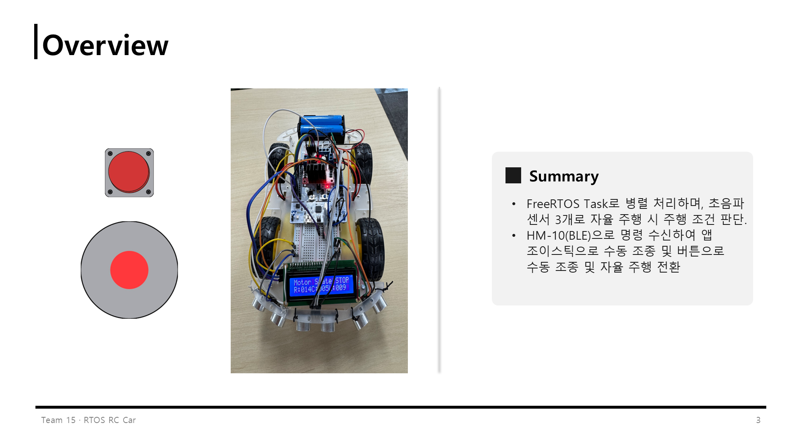

## 2. Functions

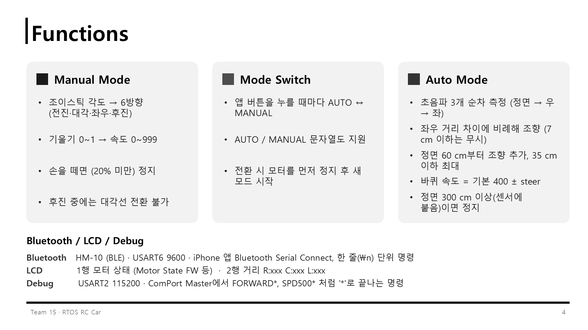

## 3. Demo

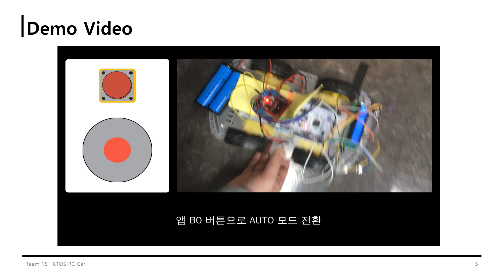

앱 B0 버튼으로 AUTO 모드로 바꾼 뒤 자율 주행하는 장면입니다.

## 4. BOM (Bill of Materials)

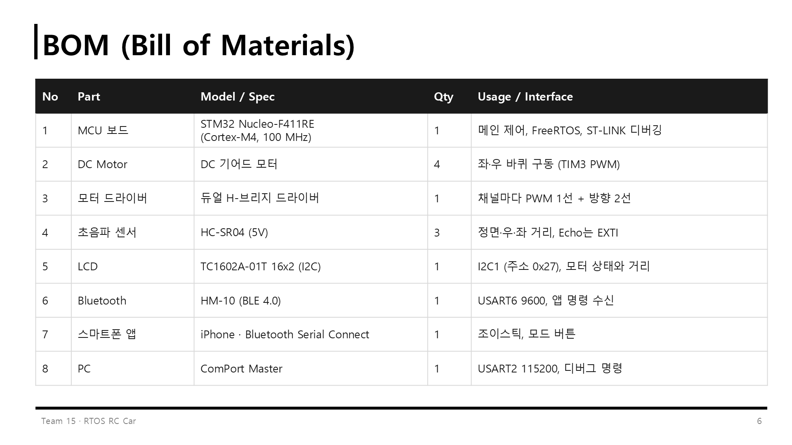

## 5. H/W Structure & Pin Map

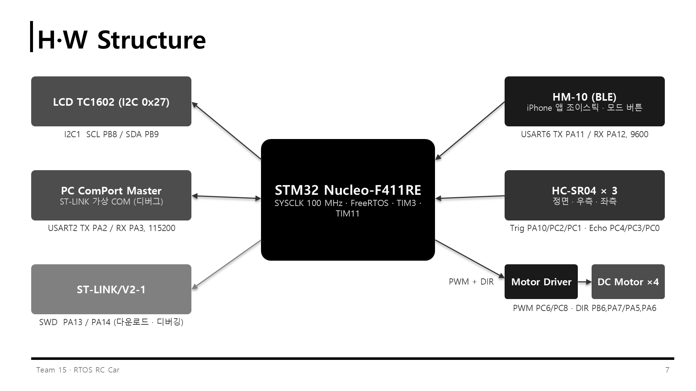

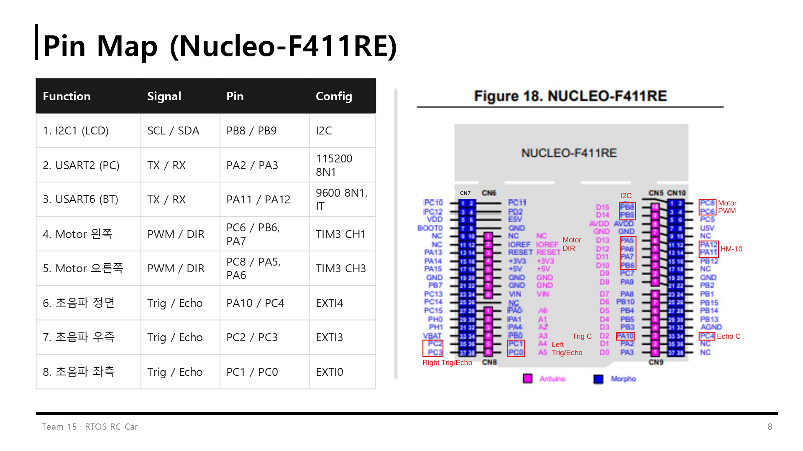

## 6. State Machine: Auto Mode

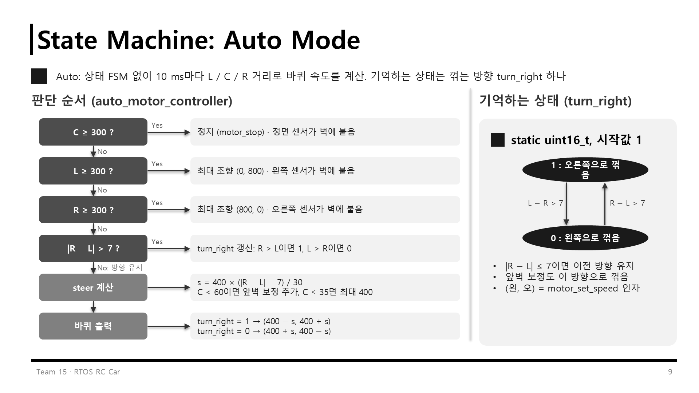

> 조향 알고리즘은 처음에 직접 짜 보다가 잘 되지 않아, AI(Claude)에게 물어 받은 비례 조향 방식을 적용했습니다.

| 튜닝값 | 값 | 의미 |
|---|---|---|
| `base` | 400 | 기본 속도 |
| `deadband` | 7 cm | 이 이하의 좌우 차이는 센서 잡음으로 보고 무시 |
| `side_full` | 30 cm | 잡음을 뺀 좌우 차이가 이만큼이면 최대 조향 |
| `front_start` | 60 cm | 정면 보정 시작 거리 |
| `front_full` | 35 cm | 정면 보정 최대 거리 |
| `far_limit` | 300 cm | 코스에서 나올 수 없는 값이라 센서가 벽에 붙은 것으로 봄 |

## 7. Troubleshooting: Right Distance Always 0

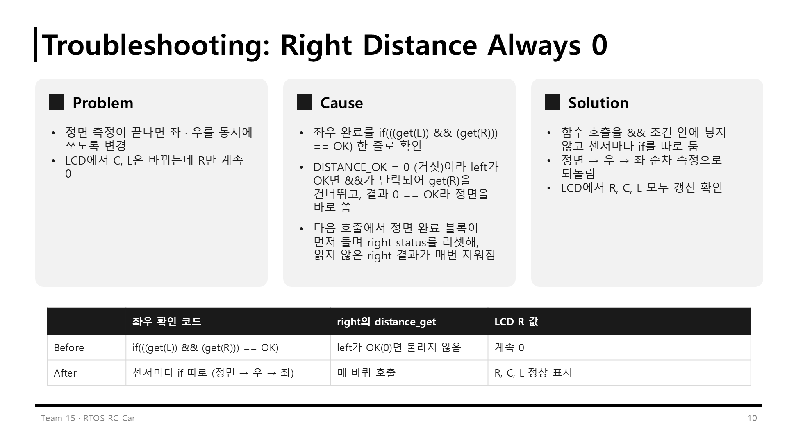

문제가 된 코드는 좌우 완료를 한 줄로 확인한 부분입니다.

```c
if(((distance_get(L...)) && (distance_get(R...))) == DISTANCE_OK)
```

`DISTANCE_OK`는 enum의 첫 값이라 0, 즉 거짓입니다. C의 `&&`는 왼쪽을 먼저 계산하고, 왼쪽이 0이면 오른쪽을 계산하지 않습니다([C11 6.5.13](https://www.open-std.org/jtc1/sc22/wg14/www/docs/n1570.pdf)). 그래서 왼쪽이 끝나는 순간 오른쪽 결과를 읽는 함수가 건너뛰어졌고, `0 == DISTANCE_OK`가 참이 되어 바로 정면을 쐈습니다. 다음 호출에서는 정면 완료 처리가 오른쪽 상태를 먼저 지워서, 오른쪽 값은 한 번도 읽히지 않았습니다.

## 8. S/W Structure

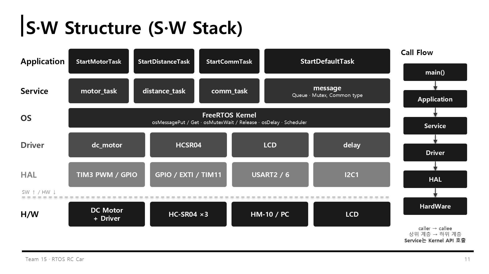

> 슬라이드에서는 FreeRTOS를 Service와 Driver 사이 층으로 그렸지만, 실제 호출 관계는 아래와 같습니다. 커널은 층 사이에 끼어 있지 않고 HAL과 나란히 하드웨어 위에 있습니다.

```
 Application   StartMotorTask, StartDistanceTask  ---->  FreeRTOS Kernel
               StartCommTask, StartDefaultTask           (CMSIS-OS v1)
      |                                                  osMessagePut / Get
      v                                                  osMutexWait / Release
 Service       motor_task, distance_task,         ---->  osDelay
               comm_task, message (Queue, Mutex)
      |                                                      |
      v                                                      |
 Driver        dc_motor, HCSR04, lcd, delay (DWT)            |
      |                                                      |
      v                                                      |
 HAL (ST)      TIM3, TIM11, GPIO, EXTI,                  SysTick, PendSV
               USART2, USART6, I2C1                          |
      |                                                      |
      v                                                      v
 ======================== Hardware (Cortex-M4 core, peripherals) ========================
```

- 직접 작성한 부분은 Application, Service, Driver이고, HAL(ST)과 FreeRTOS는 가져다 썼습니다.
- 커널 API는 Application과 Service에서만 부르고, Driver는 HAL만 씁니다.
- 커널이 SysTick(1 ms 틱)과 PendSV(Task 전환)를 쓰기 때문에, HAL의 시간 기준(`HAL_GetTick`)은 TIM10으로 옮겨져 있습니다.

## 9. AP Sequence & Timing

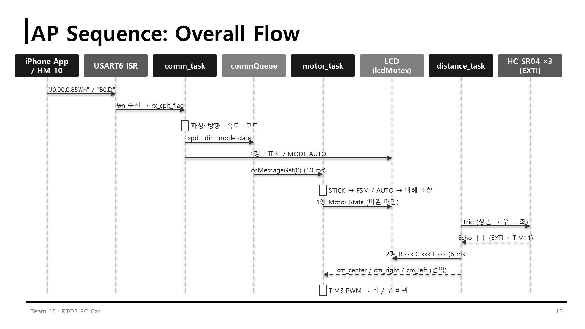

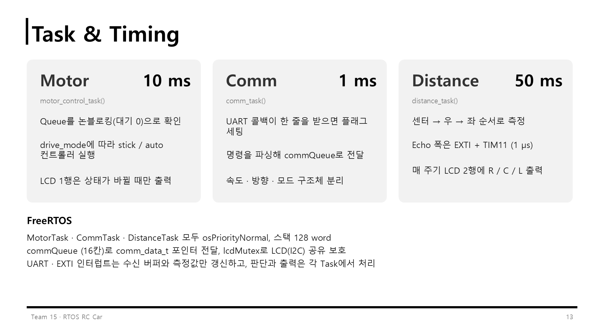

## 10. State Machine: Stick Mode

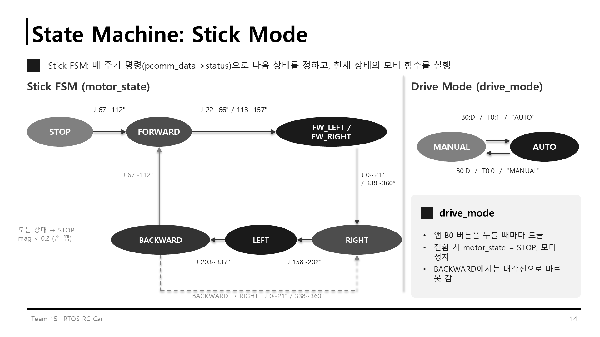

## 11. Troubleshooting: App Command Format

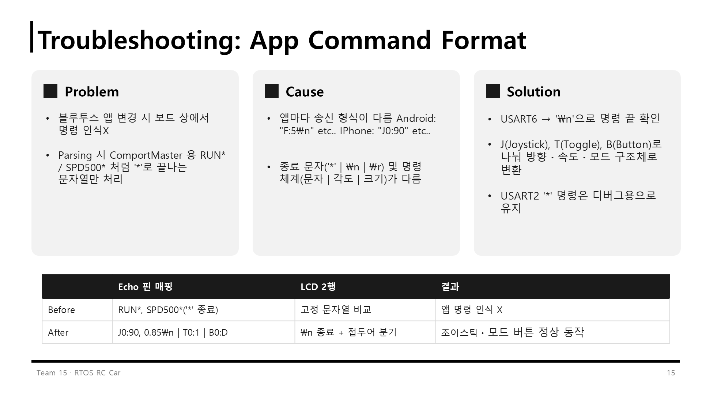

## 12. Conclusion & Discussion

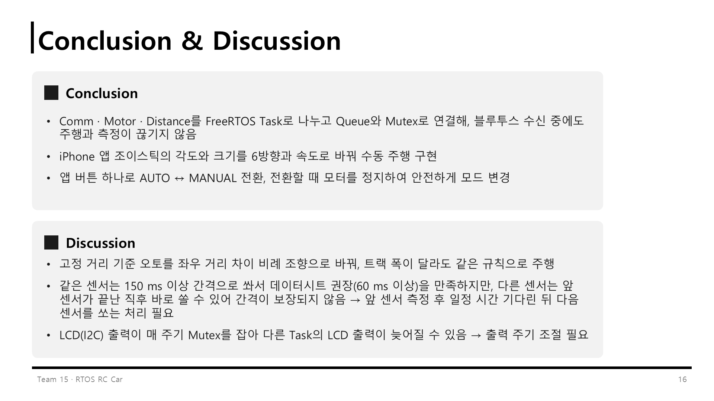

> 자율 주행은 좌우로 흔들리며 주행하는 문제가 남았습니다. 7 cm 데드밴드로 방향이 자주 바뀌는 것을 줄였지만, 초음파가 언제 돌아오는지와 측정 지연이 조향에 주는 영향을 충분히 측정하지 못했습니다. MotorTask는 10 ms마다 돌지만 각 센서 값은 150 ms 이상마다 바뀌어서, 같은 거리 값으로 여러 번 계산합니다. 막다른 곳에서 후진이나 제자리 회전 같은 탈출 동작도 없습니다.

## 13. Takeaway

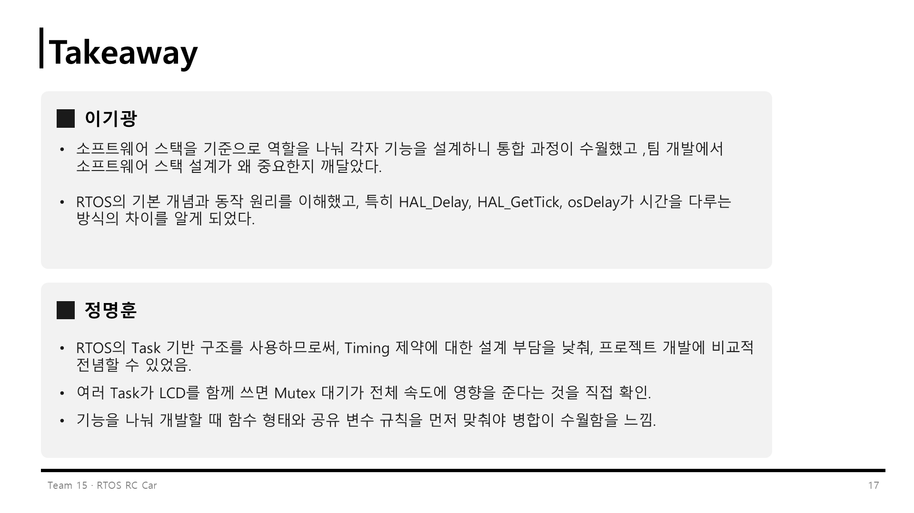

---

## 초음파 거리 측정

`ap/task/distance_task/`, `driver/HCSR04/`

- TIM11을 1 MHz로 계속 돌리고, Echo 핀의 상승과 하강 에지에서 EXTI가 카운터 값을 저장합니다. 두 값의 차이가 Echo 펄스 폭(us)이고, 카운터가 한 바퀴 넘어간 경우도 계산합니다.
- 거리는 `cm = echo_us * 17 / 1000`으로 구합니다 (음속 340 m/s, 왕복).
- 센서 3개를 동시에 쏘면 서로의 반사파를 받을 수 있어서, 정면 → 오른쪽 → 왼쪽 순서로 하나가 끝나면 다음 센서를 쏩니다.
- DistanceTask가 50 ms마다 돌아서, 같은 센서는 150 ms 이상 간격으로 측정됩니다. HC-SR04 데이터시트가 권하는 60 ms 이상의 측정 주기를 만족합니다.
- Echo가 시작되지 않으면 5 ms, 끝나지 않으면 50 ms 뒤 타임아웃으로 처리합니다.
- Echo 핀을 서로 다른 EXTI 라인(EXTI4, 3, 0)에 둬서 콜백에서 어느 센서인지 바로 구분합니다.

## 앱 명령 형식

`ap/task/comm_task/`

블루투스(USART6)는 `\n`, PC 디버그(USART2)는 `*`로 한 명령이 끝납니다.

| 명령 | 예 | 처리 |
|---|---|---|
| 조이스틱 | `J0:90,0.75` | 각도 → 방향, 크기 × 999 → 속도. 크기 0.2 미만이면 정지 |
| 토글 | `T0:1` / `T0:0` | AUTO / MANUAL |
| 버튼 | `B0:D` | 누를 때마다 AUTO와 MANUAL 전환 (`B0:U`는 무시) |
| 문자열 | `AUTO`, `MANUAL` | 모드 전환 |
| PC 디버그 | `FORWARD*`, `SPD500*` 등 | 방향, 속도 직접 지정 |

| 조이스틱 각도 | 방향 |
|---|---|
| 67 ~ 112 | 전진 |
| 22 ~ 66 | 우측 대각 전진 |
| 113 ~ 157 | 좌측 대각 전진 |
| 158 ~ 202 | 좌회전 |
| 203 ~ 337 | 후진 |
| 338 ~ 360, 0 ~ 21 | 우회전 |

## 폴더 구성

```
12.minicar/
├── README.md
├── images/                 발표 슬라이드 이미지
├── freertos.c              Task, Queue, Mutex 생성
├── ap/
│   ├── message.c/h         Queue, Mutex 핸들, 명령 구조체
│   └── task/
│       ├── comm_task/      UART 수신, 명령 해석
│       ├── motor_task/     수동 상태 머신, 자율 조향
│       ├── distance_task/  초음파 순차 측정, LCD 거리 표시
│       └── button_task/    (미사용)
├── driver/
│   ├── dc_motor/           PWM, 방향 핀 제어
│   ├── HCSR04/             Trig, Echo 에지 측정
│   ├── lcd/                I2C 16x2 LCD
│   └── button/
└── common/delay/           DWT 기반 us 지연
```

## 실행 방법

이 폴더에는 직접 작성한 소스만 있습니다. CubeMX로 아래 설정의 NUCLEO-F411RE 프로젝트를 만든 뒤, `freertos.c`, `ap/`, `driver/`, `common/`을 `Core/Src`에 넣고 빌드합니다.

- SYSCLK 100 MHz (HSE + PLL), FreeRTOS CMSIS_V1, HAL timebase TIM10
- Task: defaultTask, MotorTask, ButtonTask, CommTask, distanceTask (모두 osPriorityNormal, 스택 128 word)
- Queue: btnQue, commQueue (16칸, uint32_t), Mutex: lcdMutex
- TIM3: PSC 99, ARR 999, CH1 (PC6), CH3 (PC8) PWM
- TIM11: PSC 99, ARR 65535
- USART2 115200, USART6 9600 (인터럽트), I2C1 (PB8, PB9)
- GPIO: 핀 맵 슬라이드 참고. Echo 핀(PC4, PC3, PC0)은 상승과 하강 에지 EXTI

## Contact

- GitHub: https://github.com/Gigwangwakeup
- LinkedIn: https://www.linkedin.com/in/%EA%B8%B0%EA%B4%91-%EC%9D%B4-538212345/
- Email: gigwangwakeup@gmail.com
